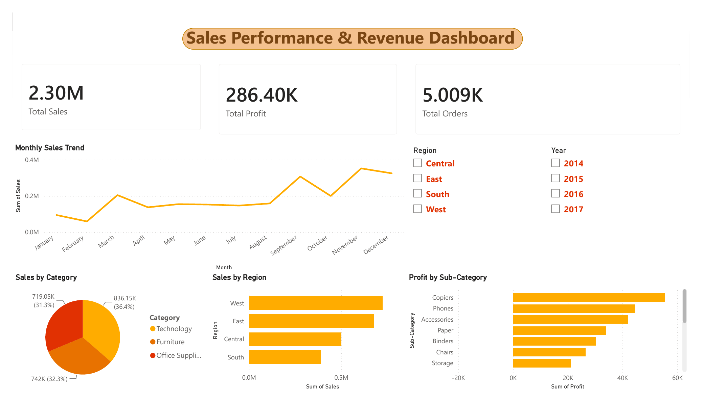

# 📊 Sales Performance & Revenue Dashboard

An interactive business intelligence dashboard built with Power BI analyzing ~10,000 rows of Superstore sales data.

---

## 📌 About The Project

This dashboard provides a comprehensive view of sales performance across regions, categories, and time periods. It enables business stakeholders to identify trends, compare regional performance, and track profitability at a glance.

---

## 🔍 Key Insights

- **Technology brings in the most sales** (836K, 36.4%), followed by Furniture (742K, 32.3%) and Office Supplies (719K, 31.3%).
- **West is the strongest region and South the weakest** in total sales.
- **Sales are seasonal:** they climb from September and peak around November, while February is the lowest month.
- **Copiers are the most profitable sub-category**, followed by Phones and Accessories.

---

## 📈 Dashboard Features

- **KPI Cards** — Total Sales (2.30M), Total Profit (286.40K), Total Orders (5.009K)
- **Monthly Sales Trend** — Line chart showing sales patterns across all 12 months
- **Sales by Region** — Horizontal bar chart comparing East, West, Central, South
- **Sales by Category** — Pie chart breaking down Technology, Furniture, Office Supplies
- **Profit by Sub-Category** — Bar chart identifying most and least profitable sub-categories
- **Interactive Slicers** — Filter by Region and Year dynamically

---

## 🛠️ Built With

- Power BI Desktop
- DAX (Data Analysis Expressions)
- Power Query
- Microsoft Excel
- Superstore Sales Dataset (~10,000 rows)

---

## ⚙️ DAX Measures Engineered

- `Profit Margin %` — Profit as percentage of Sales
- `Total Orders` — Distinct count of Order IDs
- `Avg Order Value` — Average revenue per order
- `Total Discount` — Sum of all discounts applied
- `MoM Growth` — Month over Month sales growth

---

## 📂 Files

| File | Description |
|------|-------------|
| [`Sales-Dashboard.pbix`](Sales-Dashboard.pbix) | Power BI dashboard file (open with Power BI Desktop) |
| [`Sales-Dashboard.pdf`](Sales-Dashboard.pdf) | PDF export of the dashboard |
| [`dashboard.png`](dashboard.png) | Dashboard screenshot |
| [`Sample - Superstore.csv`](Sample%20-%20Superstore.csv) | Source dataset |

---

## 👩‍💻 Author

**Samistha Kesarwani**

